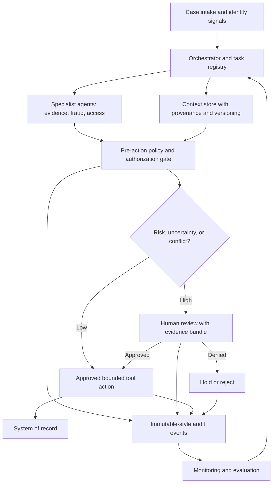

# Proposed reference architecture

## Components and trust boundaries
- **Orchestrator:** Tracks case state, agent responsibilities, deadlines and retry limits; it cannot bypass policy enforcement.
- **Agent identity:** Every agent receives a scoped service identity, approved tools and expiration; no shared privileged credentials.
- **Context service:** Stores source IDs, timestamps, confidence, consent/retention flags, policy version and case version; minimizes sensitive data exposure.
- **Policy decision point:** Evaluates actor, action, resource, purpose, evidence sufficiency and risk before changes to authoritative systems.
- **Human review:** Receives a concise evidence bundle, disagreement summary, recommended action, and explicit approve/deny/return controls.
- **Audit and monitoring:** Correlates agent traces, policy evaluations, human approvals, tool outcomes and recovery events without exposing unnecessary personal information.

## Failure behavior
On stale evidence, missing provenance, policy unavailability, conflicting identity attributes, or excessive retries: block consequential actions, preserve state, and route to a designated reviewer. All tool writes should be idempotent where possible, with compensating actions for reversible changes.

## Security notes
Agent outputs are untrusted inputs; retrieved documents and external messages cannot alter system-level instructions or authorization. Separate reasoning traces from necessary audit evidence to minimize privacy exposure.
